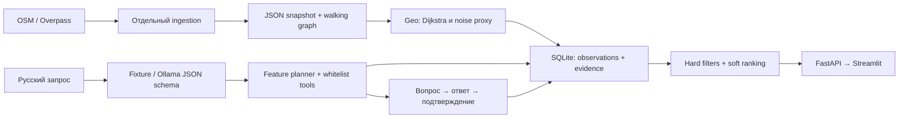

# Архитектура MVP

Область: прибрежный Адлер, подтверждено пользователем. Центр Сочи не входит в выборку.
Модульный Python-монолит: FastAPI + Pydantic + SQLAlchemy/SQLite; Streamlit обращается только по HTTP.
Это описание выбранной архитектуры; готовность подтверждается отдельно в TASKS и VALIDATION.

Каждое наблюдение имеет subject, feature, значение, source, дату, TTL, метод, уровень уверенности и flags.
Неизвестное, просроченное и противоречивое значение не удовлетворяет строгому фильтру.
Room-условия проверяются совместно на одном номере, нельзя объединить вид из одного номера с шумоизоляцией другого.
Демонстрационные ответы отделены от реальных данных и используются в подборе только при явном demo-переключателе.

Агент — ограниченный детерминированный planner по feature registry, не универсальный автономный LLM.
Он выбирает чтение факта, разрешённый локальный Geo-инструмент или вопрос отельеру. Trace доступен через API.
Сетевая выгрузка не запускается во время поиска. Пересчёт старого snapshot не обновляет дату его наблюдения.

Демо parser — точное сопоставление с известными запросами. Произвольный русский текст обслуживается
Ollama с JSON schema; без модели незнакомый запрос возвращает уточнение, а не придуманные фильтры.
Наличие кода Ollama не равно проверенному качеству модели: это измеряется отдельной командой.

Подготовка графа OSMnx вынесена в optional dependency `geo`: для запуска сохранённого демо она не нужна.
Для карты есть локальная схема без тайлов; онлайн Folium дополнительно использует CDN/тайлы.
Реальные входы требуют ручной проверки: при привязке центроида ставится estimated и low confidence.
Цена, доступность бронирования, реальная тишина, DEM/видимость, авторизация отельера — вне P0.
